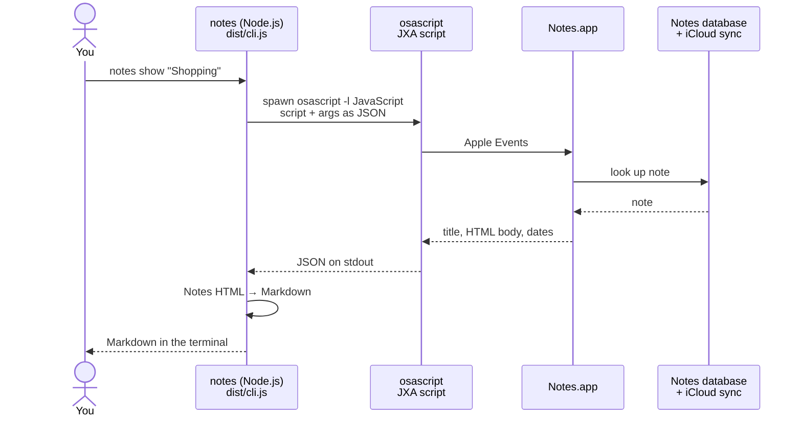
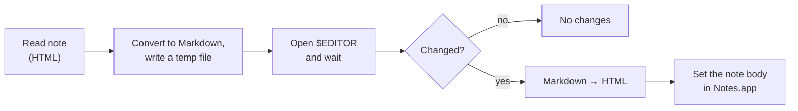
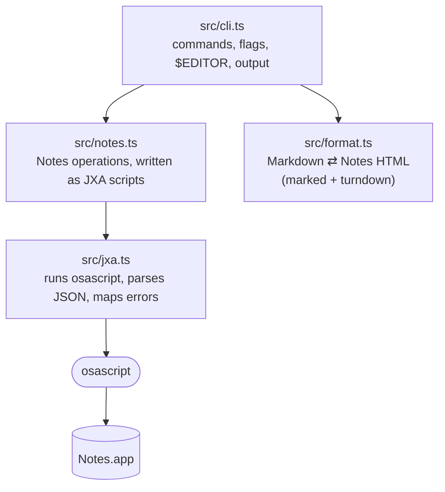

# notes — Apple Notes from the terminal

Read, create and edit Apple Notes on macOS. Talks to Notes.app through JXA (`osascript -l JavaScript`); no private APIs, no database access.

## Install

```sh
npm install
npm run build
npm link        # puts `notes` on your PATH
```

The first run triggers a macOS prompt ("… wants to control Notes"). Allow it. If you denied it, re-enable it under
System Settings → Privacy & Security → Automation.

## Usage

A `<note>` is a title, a short id (`p123`, shown by `notes list`) or a full `x-coredata://…` id.

```sh
notes folders                          # folders with note counts
notes list [-f Folder] [-n 50 | -a]    # newest first
notes search "invoice"                 # title or text, case-insensitive
notes show "Shopping"                  # Markdown (default) | --plain | --html | --json

notes create -t "Ideas" -b "first **bold** idea"
notes create -t "Log" -f Work --file log.md
echo "from a pipe" | notes create -t "Piped"
notes create -e                        # write it in $EDITOR

notes edit "Ideas"                     # open the whole note in $EDITOR (Markdown)
notes edit "Ideas" -a "- another idea" # append
notes edit "Ideas" -b "new body"       # replace body, keep title
notes edit "Ideas" -t "Better ideas"   # rename
cat new.md | notes edit p123           # replace body from stdin
```

Read commands accept `--json` for scripting. Exit code is 2 when a note/folder isn't found and 1 for other errors.

## How it works

Everything runs locally on your Mac. There is no server. Each command starts a short-lived Node.js
process, which asks Notes.app to do the work through **Apple Events** (the macOS mechanism behind AppleScript), prints the
result and exits.



Writes follow the same path in reverse: your Markdown is converted to Notes HTML, and the script tells Notes to create the
note or replace its body. Notes saves it, and iCloud syncs it to your other devices as usual. The CLI never touches the
Notes database files directly.

`notes edit <note>` with no flags adds a round trip through your editor:



### Code layout



- **No public API.** Apple has no Notes API for developers, but Notes.app is scriptable. The scripts in `src/notes.ts` use
  JXA (JavaScript for Automation) and run inside `osascript`, not inside Node.
- **Safe arguments.** Note text is passed to the script as a separate JSON argument and never pasted into the script code,
  so quotes, newlines or emoji can't break it.
- **Notes stores HTML.** Each line is a `<div>`, and the first line is the title. `src/format.ts` maps one div to one
  Markdown line.
- **Speed.** Lists read each property for a whole folder in one Apple Event instead of one event per note.
- **Permissions.** The first time, macOS asks whether your terminal app may control Notes. The permission belongs to that
  terminal app, so a different terminal may ask again.

## Limitations

- **Formatting is approximate.** Bold, italic, strikethrough, headings and lists round-trip, but colours, fonts,
  checklists and tables don't. Use `--html` with `show`/`edit`/`create` to work with the raw HTML instead.
- **Attachments**: rewriting the body of a note with attachments may drop them, so `edit` refuses unless you pass `--force`.
- **Locked notes** are listed with `[locked]` but can't be read or edited.
- **Titles**: Notes uses the first line as the title, so `--title` rewrites that line.
- No delete command, on purpose. Delete notes in Notes.app.
